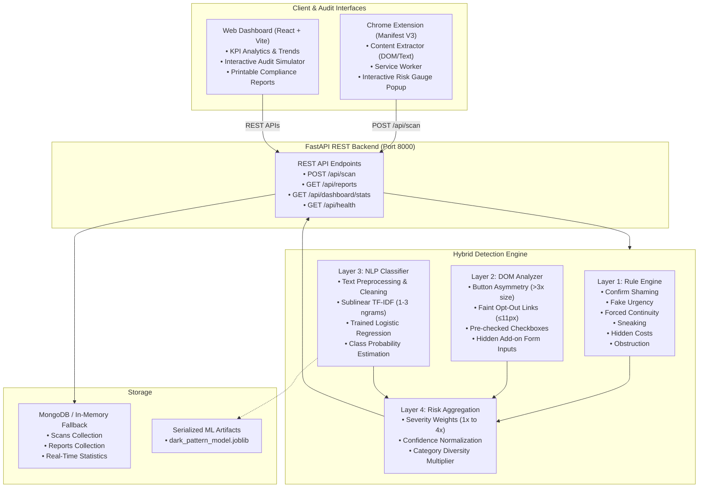

# AI-Powered Dark Pattern Detection System (DarkGuard)

> A production-grade, multi-layer cybersecurity and artificial intelligence system engineered to identify, classify, and mitigate deceptive user interface designs in real time.

---

## 1. System Overview & Objective

Deceptive user interface designs (**Dark Patterns**) are deliberate design choices that manipulate users into making decisions counter to their intent—such as purchasing unneeded add-ons, surrendering sensitive personal data, or getting trapped in recurring billing. 

**DarkGuard** addresses this through an empirical, multi-layer hybrid detection architecture:
1. **Rule-Based Engine**: Deterministic detection targeting unambiguous manipulation phrases, pre-selected options, and suspicious countdown triggers.
2. **DOM & Structural Analyzer**: Element geometry and layout analysis detecting button size asymmetry, camouflaged decline links, and hidden input payloads.
3. **Machine Learning / NLP Pipeline**: TF-IDF feature extraction coupled with a multi-class Logistic Regression classifier trained on labeled deceptive interface rhetoric.
4. **Scoring & Risk Aggregation**: Multi-factor risk calculation (0–100) weighting severity, detection confidence, and category diversity.

Both the **Chrome Browser Extension** (Manifest V3) and the **React Analysis Dashboard** communicate with the unified **FastAPI** backend.

---

## 2. Architecture



---

## 3. Core Dark Pattern Taxonomies Detected

| Dark Pattern Category | Detection Mechanism | Example Evidence Detected |
|---|---|---|
| **Confirm Shaming** | NLP Classifier + Rule Engine | *"No thanks, I hate saving money and prefer paying full price"* |
| **Fake Urgency** | Regex Rule + DOM Timer Inspection | *"Only 2 minutes left! 4 people are viewing this right now"* |
| **Sneaking / Pre-selection** | DOM Checkbox & Form Inspection | Pre-selected checkbox automatically adding *$4.99 warranty insurance* |
| **Hidden Costs** | Text Discrepancy + Rule Engine | Undisclosed *$12.99 mandatory processing fee* revealed at payment |
| **Forced Continuity** | NLP Semantic Model + Regex | *"Free 7-day trial automatically renews at $49.99/mo until cancelled"* |
| **Obstruction (Roach Motel)**| DOM Link Analyzer + Rule Engine | Account cancellation requiring physical mail or calling a toll-free hotline |
| **Misdirection** | DOM Geometry & Contrast Analyzer | Prominent 300px Accept button vs camouflaged 9px Decline link |

---

## 4. Technology Stack

- **Backend**: Python 3.11, FastAPI, Pydantic v2, Motor (async MongoDB), Uvicorn.
- **Machine Learning**: Scikit-Learn, Pandas, NumPy, Joblib, TF-IDF Vectorization, Logistic Regression.
- **Frontend Dashboard**: React 18, Vite, Tailwind CSS, Lucide React icons, Recharts data visualization.
- **Browser Extension**: Chrome Extension Manifest V3, Content Script DOM Extractors, Background Service Worker, Chrome Storage API.
- **Testing**: Pytest test suite covering rules, ML classifier, scoring engine, and API endpoints.

---

## 5. Quick Start Guide

### Step 1: Backend Setup & ML Model Training
```bash
cd backend

# 1. Install Python dependencies
pip install -r requirements.txt

# 2. Train the Machine Learning model on labeled dataset (200+ samples)
python -m ml.train_model

# 3. Launch FastAPI backend
uvicorn app.main:app --reload --host 0.0.0.0 --port 8000
```
*API interactive documentation will be live at `http://localhost:8000/docs`.*

### Step 2: Dashboard Setup
```bash
cd dashboard

# 1. Install Node dependencies
npm install

# 2. Run Vite development server
npm run dev
```
*Web Dashboard will be live at `http://localhost:5173`.*

### Step 3: Install Chrome Extension (Manifest V3)
1. Open Google Chrome (or Microsoft Edge / Brave).
2. Navigate to `chrome://extensions/`.
3. Enable **Developer mode** (toggle in upper right).
4. Click **Load unpacked** and select the folder:
   `c:\dark pattern prj\extension`
5. The **DarkGuard** shield icon will appear in your browser extension toolbar!

---

## 6. Convenience Launcher Scripts (Windows)

- Double-click **`run_backend.bat`** to train the model and start the FastAPI server.
- Double-click **`run_dashboard.bat`** to start the React dashboard.

---

## 7. Running Automated Tests

Run the comprehensive pytest suite:
```bash
cd backend
pytest tests/ -v
```

Tests validate:
- Individual category detection rules (Confirm Shaming, Urgency, Sneaking, Forced Continuity, Hidden Costs).
- False-positive resistance on clean, non-deceptive websites.
- Risk score weighting and severity calibration.
- End-to-end API endpoints via FastAPI `TestClient`.

---

## 8. Privacy & Data Security by Design

DarkGuard is strictly privacy-preserving:
- **No Password Collection**: Password fields (`type="password"`) are stripped in the browser before extraction.
- **No Financial Data**: Credit card and payment card input values are sanitized client-side.
- **No Token Transmission**: Local session storage, cookies, and authentication tokens are never captured or transmitted.
- **Selective Extraction**: Only visible text snippets, button geometry, and checkbox states required for pattern classification are analyzed.

---

## 9. Interview Demonstration Guide

When presenting this project during engineering and trainee interviews:
1. **Explain the Hybrid Problem**: Highlight why pure keyword matching has high false positives (legitimate sales vs manipulative timers), and why pure ML misses DOM visual asymmetry (huge button vs tiny button). The hybrid engine solves both.
2. **Demonstrate the Dashboard**: Open `http://localhost:5173`, click **Scan**, select the preset demo *"Flash Sale (Urgency + Shaming)"*, and show the real-time classification, risk gauge, and evidence breakdown.
3. **Show the Chrome Extension**: Open an e-commerce page, click the extension icon, and show instant DOM extraction communicating with the FastAPI service worker.
4. **Highlight the Code Quality**: Show the decoupled architecture, Pydantic v2 type safety, async MongoDB with in-memory fallback, and automated test coverage.

